# SUPER TELEVISION (Orange, Aug 1996) - effects, timing and what is exact

*Super Television* by **Orange** (August 1996). `DEMO.EXE` is PMODE/W 1.20 + Watcom C (32-bit flat), `DATA.DAT` is 29 chunks (`re/assets/00..27.bin`; the
RIX3 pictures are converted to `re/assets/png/`), the music is `MAKAKO.S3M` (251 s). The original wants a GUS or a Sound Blaster. Names of the effects below are
**descriptive only**: no credit text was read from the program. Everything here comes from `web/fx/*.js`, `re/NOTES.md` and the disassembly (`re/emu.py` +
`re/fx_oracle.py` run the original under Unicorn; the asm write-up has the listings).

The port has the same shape for every effect: `render(t, ctx)` fills `ctx.idx` (320x200 palette indices) and `ctx.pal` (768 bytes), `t` = music seconds since the
start of effect 0 (`web/fx/common.js`). It shows the indexed frame in a 4:3 box (pixels are not square; effect 9 is 320x400 and is shown in the same 4:3 box).

## 0. Honest status

Reference = the original run under Unicorn with a virtual clock and no sound card (`re/fx_oracle.py`: hooks before the render call and after the VRAM/DAC
write, one snapshot per frame). "Exact" below means **0 differing pixels in palette-index space on the oracle frames** (given the per-frame state the check feeds).

| fx | pixels | palette | what is NOT derived |
|---|---|---|---|
| 0 | 2822 of 2824 oracle frames (0 differing); 1922 frames without an ISR tick between two passes: pixels and palette | +-1 on 389 of 902 ticked frames, UNRESOLVED | the 2 other frames are a music row/order change inside one render (harness updates the row per 20000-instruction chunk; frame 1453 unexplained); entry tick count NINIT=15 and pace are harness values |
| 1 | 0 bad pixels on the 240 frames with a clean snapshot (326 had an ISR tick inside the table build, skipped, not claimed) | exact on 434 frames without a tick before the DAC load | entry (derived from fx0's ISR, sub-tick phase not), pace (1 vsync/frame assumed) |
| 2 | 0 differing pixels, 0 differing palette bytes on 222 frames (given its state) | exact | the t -> tick mapping (entry = exit of fx1, machine dependent), +-1 tick |
| 3, 8 | 0 differing pixels (fx3 875 frames, fx8 852) | exact on frames without a tick during the pass | NINIT (fx3 8), EXIT (fx8 8): harness measurements |
| 4 | 0 differing pixels on 223 clean frames (the first 40 are skipped, see 4.5) | 0 bad on 273 frames | start-up tick (1) and ticks per pass (TPF=3): harness |
| 5 | 0 differing pixels on all 1135 frames | 0 bad frames | ticks per pass (2, first pass at tick 12): about 60 % of frames are exact end to end |
| 6, 7, 12 | 0 differing pixels (about 120 frames each) | within one fade step (vsync phase unknown) | emulator vsync phase |
| 9 | 0 differing, frames 0..347 of 350 | exact | frame rate (13 fps is a free choice), entry |
| 10 | 0 differing on 1400 frames | within +0..5 ticks on 1394 of 1400 | entry (order 31 row 0) and frame rate (35 fps, free choice) |
| 11 | 0 differing on 76 frames, palette too | static | `n` -> time mapping (entry = start of order 35) |

Clock facts that apply to all of them (`re/NOTES.md`, "Original player clock"): the effects pace on **vsync** (port 0x3da) and on a **70.0027 Hz PIT tick**
(divisor 0x4295 = 17045); the music is driven by the **sound card clock** in the original (`0x3dde9`), not by the PIT. The phase between those two clocks is
machine dependent, so the "pacing" constants (NINIT, EXIT, TPF, FPS) are *measured on the emulator*, not derived. The timeline stays on libopenmpt row times
(`web/fx/timeline.js`) because that is the audio the browser plays; the original's own clock would put row starts up to 0.14 s later at the end.

## 1. Display and timing

* **Mode X (unchained 320x200, 4 planes) for the realtime effects, mode 13h for fx4/5/10/11 (the effects that build 320x200 in linear memory)**, and fx9 is a
  320x400 unchained mode (CRTC 0x13 = 0x28). 320x200 on a CRT is 4:3: pixels are 1.2 times taller than wide.
* **The demo is keyed on the S3M position.** The player tick `0x3d980` keeps the order in `[0x44505]`, the row in `[0x44504]`; effects wait on
  `cmp [0x44505],N` and flash/fade on rows. The port reads `timeline.js` (libopenmpt row start times of all 2400 rows) so **seek = set the time and re-render**.
* **Each effect installs its own ISR** on IRQ0 before it starts (master `0x1c2c8..0x1c449`), counters restart at the entry. The scenes are functions of
  (tick count, music row) plus a few accumulations per rendered frame.
* **Palette = scaled copy of a 6-bit palette, every frame.** The same loop (multiply by a fade 0..0x180+, `sar 8`, clamp 63) is used by all effects (asm 11); the
  flash is "set the fade to 0x180 on a row, then subtract per tick/vsync".

## 2. Timeline

Music time since the start of effect 0 (= start of the demo); orders from `re/NOTES.md`.

| fx | time | orders | what you see (descriptive) | chunks |
|---|---|---|---|---|
| 0 | 0 - 59.7 s | 0 - 8 | noise/zoom texture fading in, warped texture sprites, a picture sequence (orders 5-7), flashes | 16,3,4,0,1 |
| 1 | 59.7 - 76 | 8 - 10 | green "eye" disc with the SUPER television corner logo | 8,4,9 |
| 2 | 76 - 89.7 | 10 - 13 | big "TV" logo seen through a lens | 6,7,2 |
| 3 | 89.7 - 102.3 | 13 - 15 | flat-shaded purple/white abstract image, upscaled 8x | 13,22,23 |
| 4 | 102.3 - 115.1 | 15 - 17 | orange TV logo, distortion with feedback | 14,15 |
| 5 | 115 - 144 | 17 - 21 | bump-mapped spinning ball, then a picture | 5,11,10,17,21 |
| 6 | 144 - 153 | 21 - 23 | Bob Marley picture, flashes on rows | 24 |
| 7 | 153 - 159 | 23 - 24 | flag/palm picture, flashes on rows | 25 |
| 8 | 159 - 175 | 24 - 26 | swirl/zoom (the fx3 engine with other pictures) | 22,23 |
| 9 | 175 - 202 | 26 - 31 | coloured TV static, 160x120 RGB triplets | 18 |
| 10 | 202 - 230 | 31 - 35 | warped organic texture with a bump look | 19,20 |
| 11 | 230 - 244 | 35 - 37 | same texture in sepia, scrolling text strip | 20,27 |
| 12 | 244 - 252 | 37 - 39 | Marilyn portrait, fade-out, the demo ends (exit code 2) | 26 |

## 3. Effect by effect

### 3.0 fx0 (0x45a30) - intro, 8 "scenes" in one loop
One loop pass per vertical retrace (poll at `0x45dd1`). A pass is: **palette** (cross-fade of 4 six-bit palette sets by two weights, scaled by several fade
variables), **render** (`0x4507a`), **page flip** (3 pages at 0, 0x5355, 0xa6aa; CRTC start = page just drawn), **DAC upload**. The render has three layers:

1. *Noise/animation grid* (`0x46603`): a 40x25 grid; each cell value is a crossfade `(PIC16[i]*b68 + N[i]*b64) >> 11` (clamped to 63) of the picture animation (chunk 16, RLE
   decoded to 300 pictures of 40x25) and a **smoothed noise buffer** `N[i] = ((rnd&0x3f) + 3*N[i]) >> 2` refreshed every pass from a tiny PRNG; `b64` counts down from 0x800
   and `b68` up, so the noise fades into the pictures. Each cell is drawn as an 8x8 **bilinear patch** from its four corner values (asm 7; same routine family as fx3).
2. *Warp* (orders 1-3 and >= 8, `0x45136..0x452aa`, 4 plane passes at `0x452ee`): **separable**, `pixel = tex[X[x] + Y[y]]` with `X[320]` (columns) and `Y[200]`
   (rows, already x320) rebuilt every pass as clamped 16.16 ramps (asm 9); index 0 of the texture is transparent. Order 3 swaps the two texture buffers on a PRNG and from row 0x1f
   makes the zoom accelerate; at the `b78` wrap (0x1400000) both textures are cleared.
3. *Picture* (orders 5-7, and order 4 on row 0x3f): the 320x100 pictures (chunk 3, RLE, 31 of them, index from the tables at `0x550e9/0x551e9/0x552e9` by `row & 63`) are copied to rows 50..149, 0 transparent.

```js
const m=(i)=>{const v=(Math.imul(PIC16[s+i],S.b68)+Math.imul(N[k+i],S.b64))>>11;return v>0x3f?0x3f:v};   // fx00.js noise()
N[i]=((eax&0x3f)+N[i]*3)>>2;eax=(eax+0x9d)|0;eax=(eax<<11)|(eax>>>21);eax^=0x9d;                       // the PRNG
```
The palette brightness of orders 5-7 is modulated by `(SIN[b94]>>4)+0x100`. The loop ends after the pass where `[0x4dbec]==0 && [0x4dfc8]==0xff80`: derived from the
ISR (it takes **115 ticks** after order 8 starts), which is how the entry of fx1 is computed (59.68 s).
*Status*: the ISR is ported 1:1 (`isrStep`, variables named by the low digits of their addresses); render exact (see 0). **Stateful**: noise buffer + PRNG + the
texture clears, so `render(t)` replays from pass 0 with a checkpoint every 64 passes (about 0.8 s the first time, 15-50 ms per seek).
*Not derived*: NINIT (15 ticks before the loop), the pace (one pass per 70.0866 Hz vsync is assumed to fit), palette +-1 on ticked frames.

### 3.1 fx1 (0x4705f) - the "eye" disc
Mode X, 3 pages (0, 0x7d00, 0x3e80). Two variants per two frames (A `0x46da9`, B `0x46e78`), each = 4 plane calls of `0x46d53` (64x100 pixels per plane, asm 1).
For a pixel whose background mask byte (chunk 4) is 0:

```js
out = TBL[(map + S.x + T1[map>>8] + T2[map&255]) & 0xffff]     // map = chunk 9 word, TBL = chunk 8 (+0x80808080 per dword)
```
`T1` and `T2` are 256-entry word tables rebuilt each frame by `0x46bf2` from four sine counters (`tab(a,b,da,db)`: `((SIN[b>>3]+256)>>4)<<8 | (SIN[a>>3]+256)>>4`),
`S.x` = `(SIN[c1>>2]+SIN[c2>>2]+SIN[c3>>2])>>3` from three counters advanced by 3, 5, 7 per tick. So a fixed "map" picture is **displaced per pixel by two tables indexed by its
own bytes**: the high byte picks a horizontal-ish offset, the low byte a vertical-ish one, giving a liquid warp of one stored picture with no per-pixel multiply.
Variant A writes the pixels with x+y odd, B those with x+y even, and the page written changes every frame, so the **displayed page n = chunk-4 background + half of frame n-3
+ half of frame n**; the port reproduces this (`render` draws frame k-3's half then frame k's half). Palette: colours 0..127 = `pal0*f8>>8`, 128..255 = `pal1*f4*ca>>16`. The ISR (`isrStep`, hook `0x473ef`)
also sets the per-order sine steps (orders 8, 9, 10), fades in, and from order 10 row 47 fades out by 6 per tick: fx1 **exits when the fade reaches 0** (43 ticks).
*Status*: pixels exact on clean snapshots; entry derived (fx0's exit), pace 1 vsync/frame assumed. **Seek**: pure function of (t, entry): `stateAt` replays the ISR ticks from the entry (about 10 ms/frame).

### 3.2 fx2 (0x476b4) - the TV lens
A 256x200 picture at x=48 of mode 13h. Per pixel (asm 2): `al = t1 + t2` where `t1`, `t2` are two bytes of a 512x512 texture (chunk 2, halved) read through **two windows**
whose offsets orbit on sine/cosine paths; `al` then indexes a 256x256 **lens table** twice,

```js
TBL[row*256+col] = (((row-128)*(256-col))>>8)+0x80          // built at 0x476dd, 64 KB
dh = TBL[(0x1c+y)*256 + al];  dl = TBL[x*256 + al];  out = chunk7[(al>>2)*256 + chunk6[dh*256+dl]]
```
(dh, dl) is a coordinate pair into the **picture** (chunk 6), so the texture sum is not shown, it *bends the lookup of the logo*; the final colour goes through chunk 7 (a shade table indexed by `al>>2`).
Chunk 6 is indexed by its raw file offset (header included), a quirk the port keeps (`C6[...]` on the whole file, palette from `C6.subarray(10,778)`).
Window motion (ISR `0x4799b`, 70 Hz): `A += 0x20, B += 0x1a, C += 0x18 (mod 4096)`; `m1 = sin[A] + 0x4c8`, `m2 = sin[B] + 0x4c8`;
`p50 = (((cos[C]*m1>>14)+128)<<9) + (sin[C]*m1>>14) + 128`, second window with `C+0x800`. The picture scrolls in (`off = 0xc800 - 0x500*k` from order 11, 40 ticks; rows above stay black) and fades from order 12 row 48 (`-8` per tick).
*Status*: state = closed form of the tick count N, **no accumulation**: pure f(t), seek is free. Pixels and palette exact given (A,B,C,off,fade); N is known to +-1 tick and the entry
(= fx1's exit, 43 ticks after order 10 row 47) is derived from the code, but its sub-tick phase is not. An older 0.02 s lead fit was removed.

### 3.3 fx3 (0x485b0, engine in `swirl.js`) - the 40x25 flat swirl
The picture is **not computed**: chunk 13 is RLE decoded (`0x48d29`: `b&0xc0 == 0xc0` -> repeat `b&0x3f` times the next byte) to exactly `0x493e0` bytes = **300 images of
40x25** (1000 bytes). The ISR advances an offset by 1000 (every `speed`-th tick for fx3), so the demo plays a 300-frame animation stored at 40x25. Each frame is **upscaled 8x
with bilinear interpolation** by `0x48d63/0x48e0e` (asm 7): 39x24 cells, each cell 8x8 pixels from its four corner bytes in 8.8 fixed point, written two planes at a time
(plane masks 5, then 0xa, rows 0-7 then 3-10, so the pixel lattice is a quincunx), then the borders cleared. `swirl.js draw()` reproduces the VRAM writes literally on a 4-plane array.

Palette: 128 static colours (`0x5d952`) + 128 mixed from two of four 0x300-byte tables by weights `w1` (-4/tick) and `w2` (+4/tick); after 64 ticks the pair index (6 pairs) advances,
so the colours **cross-fade between table pairs forever**; everything is scaled by `f2c2*f2a6*f483>>16` (fade-in +8/tick, flash 0x1c0 on rows R3 decaying 8/tick, fade-out 4/tick from the last order). The loop leaves when the fade hits 0 or at order 15.
*Status*: pixels exact (875 frames), ISR counters exact on all snapshots; the music-driven flash/fade values were first reported wrong on 434 snapshots, which turned out to be
a checker artifact (one row per frame fed to three ticks): fed the exact row of each tick (`IRQLOG`) they are 0 wrong. *Not derived*: NINIT=8 start-up ticks (RLE decode etc.), sub-frame phase. **Seek**: pure f(t), ISR state replayed from the entry (about 1 ms/frame).

### 3.4 fx4 (0x4917b) - orange TV with feedback distortion
Mode 13h. A 320x200 buffer `T` (the feedback state, initialised to chunk 14) is displaced every frame and mixed back into itself. Two offset tables, `H[320]` and `V[200]`, are built each frame (`0x48f1a`) from four ISR sine counters (`A += 9, B -= 38, C -= 26, D += 25`) and an amplitude `(SIN[E]+0x5dc)>>1`;
the displacement is separable (`D[y*320+x] = T[V[y] + H[x]]`, port `tables()`), then **`T = (3*D + C) >> 2` per byte** (C = chunk 14, constant) so the picture keeps being pulled
back to the original, and the VRAM byte is `((T>>2) & 15) | chunk15 << 4` (asm 4). The palette is a **16x16 construction**: `out[o*16+i] = ((P2[i]*F>>8)*9 + P1[o]*6)>>3 (<=63) * F>>8`, `o` = the chunk-15 pixel (high nibble), `i` = the feedback level (low nibble), so the feedback buffer
is *only* a brightness ramp on top of a 16-colour picture. Fade +8/tick in order 15, -8/tick from order 16 row 0x30.
*Status*: pixels exact on 223 compared frames, palette on 273, ISR counters on 1180 snapshots. The feedback error decays by 3/4 per frame, so a seek **replays from the first frame** (stateful, cached, 0.3-2 ms/frame); the oracle run needed `NOIRQ` over the table build (ticks injected inside it mixed two states), which is why the first 40 frames are not compared.
*Not derived*: NINIT=1 and TPF=3 ticks per pass (270 of 294 passes in the harness; 2: 13, 4: 11) = 23.4 fps, machine speed.

### 3.5 fx5 (0x495c1) - bump-mapped ball
A **height-map bump mapping on a 160x100 grid**, blitted as 2x2 quincunx blocks to mode 13h. Setup (`0x4968e..0x497d5`, once):

1. height `h[i] = TBL[(r+g+b) & 255]` of the *palette entry* of picture pixel i (chunk 10): the heights come from the colours' brightness;
2. **4 box blurs** of 64 KB, 4 pixels per dword: `byte = (sum of 4 neighbours >> 2) & 0x3f` (asm 3);
3. a delta table `D[i] = ((h[i-1]-h[i+1])<<2) & 255 | ((h[i-256]-h[i+256])<<2)<<8`: the **slope** as a 2D offset.

Per frame (`0x49552`, asm 3): for grid pixel i, `w` = chunk 5 word, `dx = w + OFF` (16 bit), `cl = chunk10[dx]` (the texture colour), `bp = w + D[dx]`, `ch = chunk17[bp]` (the lit shade), `out = chunk11[ch<<8 | cl]`:

```js
for(let i=0;i<16000;i++){const w=W5[i],dx=(w+off)&0xffff;out[i]=T11[(I17[(w+D[dx])&0xffff]<<8)|I10[dx]]}   // fx05.js ball()
```
`w` is the screen->(u,v) mapping of a sphere (precomputed, chunk 5), `OFF` scrolls the texture under it (spin); the slope `D` **displaces the lookup into a light map** (chunk 17), and chunk 11 is the shade table. The ISR (`0x49adf`) integrates `OFF` from per-order parameters (table `0x607aa`, 20 bytes per order) cross-faded over 256 ticks after an order change; flashes on rows 2, 5, 0x21, 0x24, 0x27, 0x3f set the fade to 0x180 and it decays by 4. At order 21 row 2 an overlay (chunk 21, index 0xf0 transparent) is composited and 256 fade frames (one per vsync) end the effect.
*Status*: pixels exact on all 1135 frames, palette on all, ISR counters exact. The setup tables are verified **through the pixels** (every pixel goes through D). The 16-bit dword reads of the blur at offsets 0xffff/0xfffd read 3/1 bytes beyond the 64K block; in the harness those bytes are 0 and the port uses 0 (`XT`) - on a real PC they are whatever the allocator left: UNRESOLVED (corner pixels only).
*Not derived*: the tick count per pass (first pass at tick 12, then 2 per pass, drifting -1 tick per ~400 passes: about 60 % of frames exact end to end); the fade frames: the harness drops ticks during vsync waits, the port uses one frame per vsync. **Seek**: pure f(t), ISR replayed from the entry.

### 3.6 fx6 (0x47f86), fx7 (0x48209) and fx12 (0x47e79) - picture + beat flash
A RIX3 picture is copied to VRAM **once**, with a black palette. Then every vsync the loop polls the row byte; on a listed row the fade is set to **0x180** and each vsync
drops it by **16**, palette = `src*fade>>8` clamped to 63 (asm 11). So the picture "pops" over-bright on the beat and sinks back to normal in 8 frames; between two flashes
the fade is at its floor, which can be 0 (a black screen, which is why a test sample at 156 s seemed blank: it lies between two flashes of fx7).

```js
fade = Math.max(0, 0x180 - 16*(k - j0))     // k = vsync index, j0 = first vsync after the flash row (flash.js)
```
fx6 (chunk 24) flashes on 23 rows of order 22, fx7 (chunk 25) on 18 rows of order 23. fx12 (chunk 26, the end) shows the picture at order 37 row 24 and fades it out at one step per frame (`256 - m`).
*Status*: 0 differing pixels; the palette is within one fade step (the emulator's time quantum is 6.7 ms against a 14.3 ms vsync, so the phase is unknowable). **Seek**: pure functions of t.

### 3.7 fx8 (0x4856a -> engine 0x485b0) - the swirl again
Effect 8 sets `[5f443]=0x17` (start order), `[5f441]=0x1a` (end), speed 2, chunk 23, then **falls into the same body as fx3**. Differences that matter: `[0x5f487]==1`
(set by fx3 at its exit) selects other ISR branches (flash rows R8 tested only on a row change, the picture advances **every** tick instead of every `speed`-th); its 128
static colours are not static data but *what fx7 left at 0x5d952* (chunk 25's palette bytes `[0xa:0x18a]`, checked equal to the oracle dump); and the ISR variables
(`[5d27a]`, `[5d26e]`, weights) are **inherited from fx3's end state** because `0x4856a` does not reset them (the port's `carry()` replays fx3 to its end, then 8 more ticks).
*Status*: 852 frames exact, palette on 665 frames without a tick in the pass, counters exact. EXIT=8 ticks between fx3's last pass and fx8's first frame is a harness measurement (UNRESOLVED). The tail at `0x48802` (final picture, needs order 25 row >= 0x3d while the fade is still > 0) is not rendered by the port because with this timeline the 64-tick fade ends first: **not verified**.

### 3.8 fx9 (0x4a186) - TV static
A 320x400 unchained mode shows **160x120 "pixels" of three bytes**: each pixel is three scanlines using palette banks 0, 0x40, 0x80 (R, G, B ramps), doubled horizontally,
360 lines drawn. The source image is chunk 18 (57600 bytes >> 2). Per frame:

1. a 3-state **LCG-like generator** (`0x4a2d9`, 4800 dwords) fills 19200 random bytes;
2. each random byte selects one of 5 offsets `{0, +-3, +-480}` (table `0x6567e`, copied in at the *end* of each frame, so frame 0 uses zeros) into the image: `dst[i] = src[i + off]` (the image **diffuses**, the two buffers swap);
3. the VRAM byte is combined with the new pixel in place: `vram = B[old - 0x40*l] + A[img] + 0x40*l` (asm 6). `A = floor(j/8)`, `B = ~0.9*k` are static ramps, so each frame the screen moves 1/9th of the way (roughly) to the new random-shifted image: **the static is the temporal low-pass of a randomly jittered picture**.

```js
for(let i=0;i<4800;i++){R[i]=x; x=(x+y)|0; y=(y+z)|0; z=rol(z,2); y=rol(y,1); x^=z; z^=x}   // fx09.js step()
```
Fade 0x100 until order 30 row 0x30, then `0x100 - 16*(row-0x30)`; exit at order 31 or after 350 frames.
*Status*: 0 differing pixels on frames 0..347 (99 dumps; each compared with the port's frame n and n+1 because the emulator samples mid-frame, two plane passes; 0 unexplained). **Frame rate not derived**: the loop does one vsync wait per frame (<= 70 fps, CPU bound), the port uses 13 fps, chosen only so that 350 frames span about orders 26.5-31. **Seek**: stateful (image + VRAM + LCG), replayed from frame 0 and cached (about 1 ms/frame).

### 3.9 fx10 (0x4a62f) - the bump-mapped warped texture
chunk 19 (320x200, first 16 colours) is the **height field**. Eight counters (`0x6b34c..`, +4 per tick from `0,1024,2048,3072,1024,2048,3072,0`) move **four sampling windows** on sine paths
(x = `(SIN*80>>10)+80`, y = `(SIN*50>>10)+50`); the four dwords are added, `>>2 & 0x3f3f3f3f`, giving `HB` (160x100): the average of four moving crops, i.e. a slowly morphing texture.
The **gradient** of HB gives the bump (asm 5): `G = -(5*64*(HB[i+640]-HB[i-640])) - (HB[i+4]-HB[i-4])` as signed bytes, i.e. `-dy*320 - dx` = a **displacement into chunk 20** (a second picture, 4 bit, `<<4`), so the second texture is seen *refracted by the slope* of the first. Pixel = `HB | chunk20[s+G]`: low nibble the height, high nibble the refracted picture.
The palette is the 16x16 product `(pal20[r]*pal19[c]) >> 4` scaled by the fade (+1/tick up to 256, -1... per tick from order 34 row 34), so the two nibbles multiply as colours.
160x90 source pixels become 2x2 blocks at y=10; **each frame only writes one diagonal of the blocks** (frame parity), so the visible picture is a function of frames k-1 and k only (`render` draws both).
*Status*: 0 differing pixels on 1400 frames; palette matches within +0..5 ticks on 1394 frames (the oracle reads the palette after the render; the 6 others, fade-in near order 29, are 3-5 ticks ahead). *Not derived*: the entry (the port uses order 31 row 0; in the golden run fx9 hit its 350 frame cap and fx10 started at 189.8 s) and the frame rate (35 fps free choice). Outside the picture (`s+G` out of range) the original reads zeroed heap: the port uses 0, "to be confirmed". **Seek**: 2 frames.

### 3.10 fx11 (0x47d60) - sepia + text strip
chunk 20 (picture, its own palette, no fade) with chunk 27 (a 320x600 text strip) over it. Every frame copies 64000 pixels: the strip pixel at offset `(n>>1)*320 + i` if non zero, else the picture pixel (asm 12): a **scroll of one line every two ticks**, 35 lines/s. `n` = `[0x5f498]`, +1 per tick of the ISR installed at entry; no cap in the original (past the strip's end it reads zeroed heap, port: 0, to be confirmed). The loop ends at order 37 (`cmp [0x44505],0x25`).
*Status*: pure f(n), 76 frames + palette exact; `n = floor((t - at(35,0))*TICK_HZ)` (entry = fx10 leaves at order 35; fx10's latency and the PIT phase are not derivable).

## 3b. The art: images, textures, tables, sprites, fonts, models

**Container.** All art is in `DATA.DAT`: 29 dword offsets (at `0x4dad8` in the unpacked image, relative to the end of the file) delimit the chunks; the program reads the whole file
into memory once (`0x44cc4`) and each effect calls `0x44c9a(chunk, dest)`, which is just a memcpy of chunk N. `re/assets/NN.bin` = the chunks as extracted (28 files, 00..27, listed here;
the table in `re/NOTES.md` says 29 dwords). Which chunk goes to which effect is the `(chunk, dest)` list at the end of `re/golden/log.txt` (recorded by hooking `0x44c9a`).

**Formats (verified on the files).**
* **RIX3 pictures**: `'RIX3'`, `w` (u16), `h` (u16), flag byte (175 in every file), 768-byte palette of **6-bit VGA values** at +10, then 8-bit palette indices at +0x30a. The port reads them with `rix()` (`web/fx/common.js`); `re/assets/png/*.png` are conversions, copied to `figures/` here.
* **Raw chunks**: no header, 8-bit indices (320x200 = 64000 bytes) or tables; they have *no palette of their own*, they are shown through the palette of another chunk or built as tables.
* **RLE chunks (3, 13, 16, 23)**: byte `b & 0xc0 == 0xc0` = repeat the next byte `b & 0x3f` times, else literal (decoders `0x46585`, `0x465c9`, `0x48d29`; port `rle()` in `swirl.js`, `fx00.js`). Chunk 3 holds 31 pictures of 0x7d00 = 32000 bytes (320x100), each with an 0x80-byte header before and 0x301 bytes after it; chunks 13, 16 and 23 decode to exactly `0x493e0` bytes = 300 images of 40x25.

| chunk | size (bytes) | what it is (verified) | used by |
|---|---|---|---|
| 0, 1 | 64000 each | raw 320x200, values 0..19 / 0..15: the two texture buffers (A, B) of the warp | fx0 |
| 2 | 262144 | raw 512x512, values up to 215: the texture of the lens windows (halved when loaded) | fx2 |
| 3 | 94299 | RLE, 31 pictures 320x100 | fx0 (orders 4-7) |
| 4 | 64000 | raw 320x200, values 0..63: fx1 background/mask, fx0 "final picture" buffer (0xf2300) | fx0, fx1 |
| 5 | 32000 | 16000 words = 160x100 sphere mapping (screen -> (u,v)) | fx5 |
| 6 | 66314 | RIX3 256x256, 256 colours: the "TV" logo picture and its palette | fx2 |
| 7, 8, 11 | 65536 each | 64 KB tables: shade/lookup (7: `(al>>2)<<8 + colour`; 8: fx1's colour table; 11: fx5's `ch<<8 | cl` shade table) | fx2, fx1, fx5 |
| 9 | 102400 | 51200 words: the "map" picture of the eye disc | fx1 |
| 10 | 66314 | RIX3 256x256, 231 colours: texture/height source of the ball | fx5 |
| 13, 23 | 181307 / 281894 | RLE, 300 images of 40x25 each | fx3 (13), fx8 (23) |
| 14 | 64000 | raw 320x200, values 0..63 (6-bit): the picture the feedback is pulled back to | fx4 |
| 15 | 64778 | RIX3 320x200, 16 colours: the orange TV logo layer (high nibble) | fx4 |
| 16 | 199668 | RLE, 300 images of 40x25 (noise-crossfade animation) | fx0 |
| 17 | 66314 | RIX3 256x256, 63 colours: light map | fx5 |
| 18 | 57600 | raw 160x120 x 3 bytes (R,G,B), shown `>>2` | fx9 |
| 19, 20 | 64778 each | RIX3 320x200, 16 colours each (height texture, refracted picture); 20 also the fx11 background | fx10, fx11 |
| 21 | 64778 | RIX3 320x200, 16 colours: overlay (index 0xf0 transparent), 16 palette entries put at 240..255 | fx5 |
| 22 | 64778 | RIX3 320x200, 16 colours (a figure on black, see below); loaded by the fx3/fx8 code, **not read by the port** (the swirl colours come from `fx03.bin`/chunk 25) | fx3, fx8 (harness log) |
| 24 | 64778 | RIX3 320x200, 61 colours | fx6 |
| 25 | 64778 | RIX3 320x200, 118 colours; its palette also colours fx8's static half | fx7, fx8 |
| 26 | 64778 | RIX3 320x200, 15 distinct pixel values | fx12 |
| 27 | 192778 | RIX3 **320x600**, 4 colours: the text strip | fx11 |
| 12 | 64000 | raw 320x200, values 0..15, looks like an eye/iris; **not loaded by any effect** in the harness log | none seen |

**Previews** (extracted with the palette of the file; raw chunks drawn as stretched grey values, not their real colours):
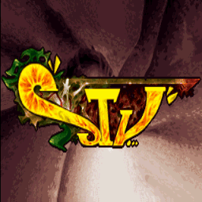 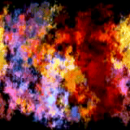 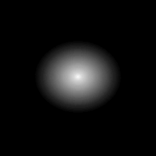 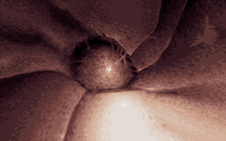
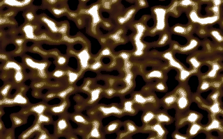  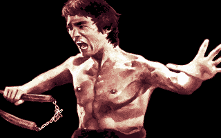 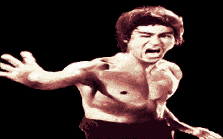
   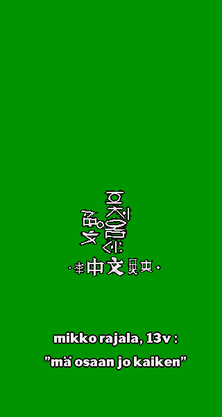
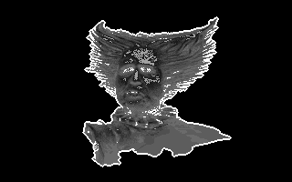  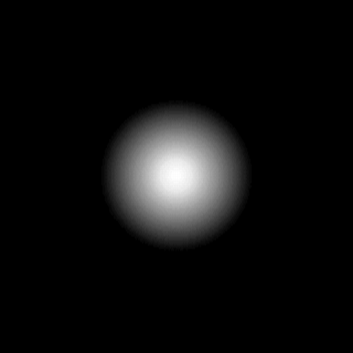
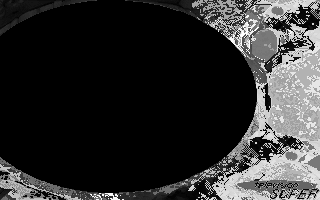 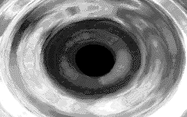 

**Sprites, fonts, 3D.** There is **no font file and no sprite sheet**: text and logos are pixels inside the pictures (the fx11 text is the 4-colour 320x600 strip, chunk 27; the
intro's sprites are the pictures of chunk 3 and the textures 0/1, drawn with index 0 as transparent). **There is no 3D model or mesh data in `DATA.DAT`**: every chunk above is a picture, a
table or an animation, and the engine code has no vertex loop; the depth impression of the ball (fx5), lens (fx2) and bumps (fx10) comes from tables and the slope of a height map (sections 3.2, 3.5, 3.9).
(`anim2.dat` and `tnldata.dat` are named in the binary but never opened in the harness run; their content is unknown.)

## 4. Cool tricks (summary)

1. **Every table is 64 KB-aligned and addressed with a 16-bit register**: a `dx`/`ax`/`cx` that holds the index leaves the high 16 bits as the table base, so lookups wrap for free and need no `and` (fx1, fx2, fx5; asm 1-3).
2. **Byte-pair indexing**: two byte registers form the 16-bit index of a 256x256 table (`ch:cl`, `ah:al`, `dh:dl`); shading, lens, blending are lookups (fx2, fx5).
3. **SWAR**: 4 pixels per dword with `& 0x3f3f3f3f` masks: the blur of fx5, the feedback of fx4, the 4-window sum of fx10 (asm 3-5).
4. **Upscaling by hardware plane masks**: fx0 and fx3 draw 8x8 bilinear patches from a 40x25 image writing two planes per store.
5. **Palettes built so that the pixel byte has structure**: fx4 and fx10 index a 16x16 palette by (picture nibble, effect nibble); fx9 uses three palette banks as RGB ramps; fx1 splits the palette in two halves with independent fades.
6. **The screen as state**: fx9 reads the VRAM back (GC read map) and feeds it through a table; fx4's feedback buffer is a recursion over all frames. Both force a seek by replay.
7. **Separable warps**: fx0 and fx4 build `X[320]` and `Y[200]` offset tables per frame; one add per pixel.
8. **Palette flashes**: set the fade to 0x180, subtract 16 per vsync; the picture is written once.

## 5. How the original was reverse engineered

1. `DEMO.EXE` is PMODE/W **1.20** (entry 0x59): `re/unpack_pmodew.py` (`ENTRY=0x59`) runs the stub under **Unicorn** and dumps the 64 MB guest memory (`re/mem.bin.gz`); `re/image.bin`/`re/low.bin` are slices (linear 0x100000.. and 0x10000..), `re/image.dis` is an objdump of the first.
2. `re/emu.py` boots the real program with host-side DOS/DPMI/VGA (planar shadow, sequencer/CRTC/GC, DAC) and a virtual clock (instructions/IPS, warped on port 0x3da polls); IRQ0 is injected every 20000 instructions at the PIT rate. `rep outsb` DAC uploads (28 sites) are patched because Unicorn cannot hook OUTS.
3. `re/golden_run.py` runs the whole demo once with the S3M variables written from `s3mtime.json` (the sound card is disabled: flag `[0x4dacc]` cleared at 0x1c2b8) and saves reference pictures (`re/golden/contact.png`); `re/fx_oracle.py` is the generic per-frame oracle (hooks, state, `IRQLOG`) behind the checks in `tools/*check.mjs`.
4. Per effect: locate the routine from the 13 call sites (0x1c2f9..0x1c449), read the ISR it installs, write the oracle hooks, port to `web/fx/fxNN.js` (variables named by the address's low digits), diff in index space (`tools/fxdiff.py`) with the exact per-tick music row.
5. Assets: `data.dat` is 29 dwords of offsets (0x4dad8) + raw chunks (`0x44c9a(chunk, dest)` is a memcpy); RIX3 = `'RIX3', w, h, flag, 768-byte 6-bit palette, 8-bit pixels` (pixels at +0x30a).
